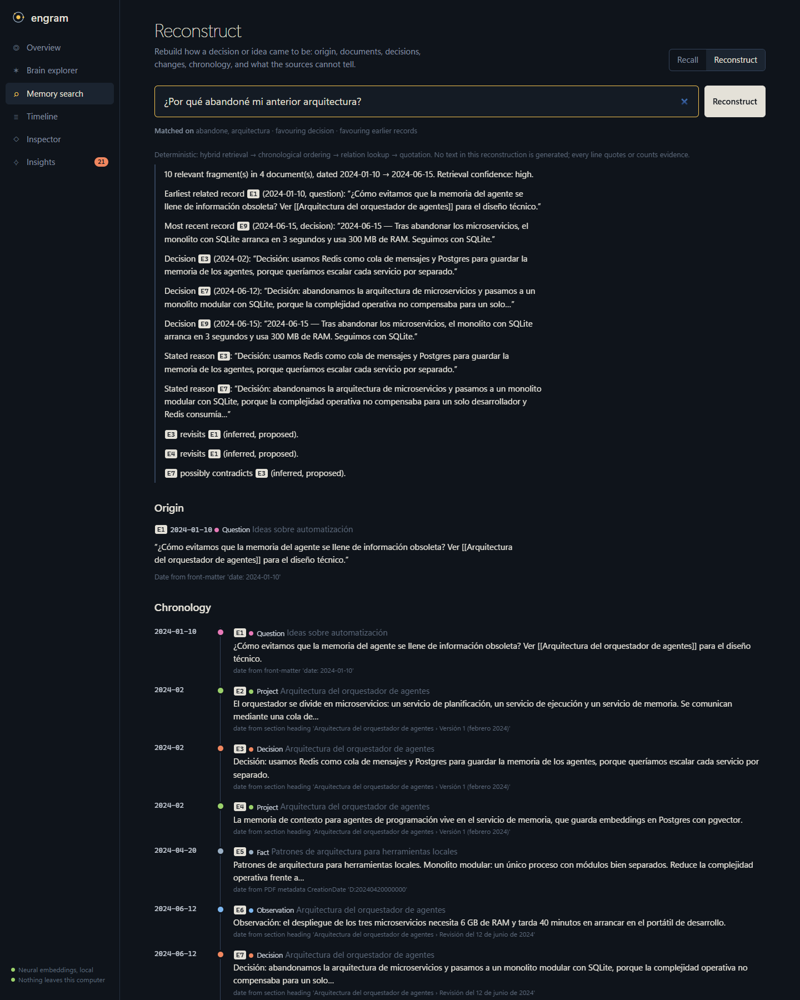
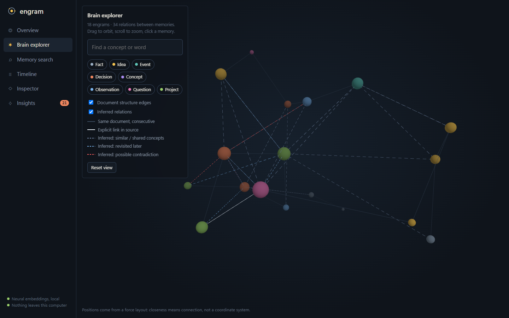
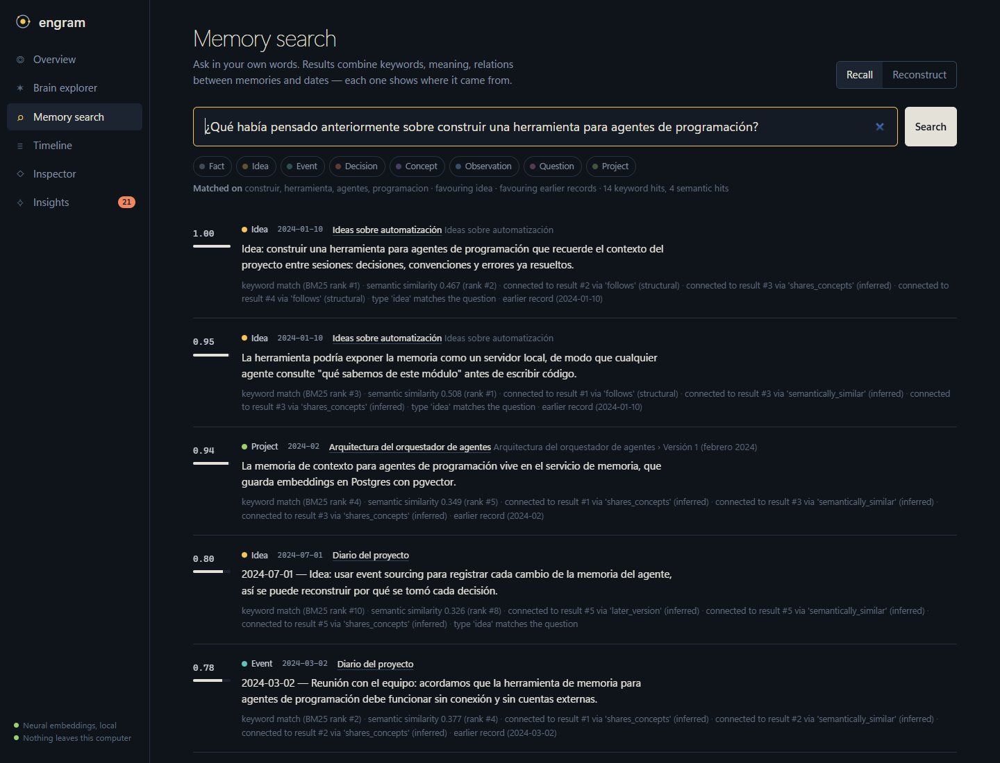

# ENGRAM

**A local-first second brain that remembers where everything came from.**

ENGRAM imports your notes, PDFs and text files, splits them into *engrams* (units of
knowledge), connects them with typed, explained relations, and lets you recall and
**reconstruct** past thinking — *why did I abandon that architecture?* — with every
statement traceable to an exact passage of an original file. It runs entirely on your
computer: no accounts, no servers, no paid APIs.



| Brain explorer (3D, real graph) | Contextual recall with provenance |
|---|---|
|  |  |

> The screenshots show the sample notes in `examples/demo-notes/`, written for this repository.

## What it does

- **Knowledge ingestion** — PDF, Markdown and plain text. Structure-aware chunking
  (headings, pages, journal entries, labelled items such as `Decisión:`), front-matter,
  `#tags`, `[[wiki links]]`, dates with their evidence, SHA-256 deduplication, and
  versioning when a file changes (old versions are kept).
- **Engrams** — each one stores verbatim content, knowledge type (fact, idea, event,
  decision, concept, observation, question, project) with the reason for the
  classification, source document, page/section and character offsets, the date and
  *where that date came from*, import time, concepts and entities, an embedding,
  relations and metadata.
- **Hybrid memory engine** — SQLite FTS5 (text) + local neural embeddings in sqlite-vec
  (vectors) + a typed knowledge graph + temporal metadata.
- **Associative memory** — proposes relations across documents, each with a type and an
  explanation: similar meaning, shared concepts, possible duplicate, possible
  contradiction, revisited later. Inferred relations are *proposals* you confirm or
  reject; links written in your notes are kept separately as explicit.
- **Contextual recall** — natural-language questions ranked by keywords, meaning,
  relations (spreading activation) and time; each result says *why* it was returned and
  where it came from.
- **Temporal memory** — timeline of dated memories, evolution of a topic, first
  appearance. No date is ever invented.
- **Consolidation** — detects duplicates, related concepts, fragmented notes,
  contradictions and new links. Never deletes or rewrites anything.
- **Reconstruction** — origin, documents involved, decisions, changes of mind,
  chronology, stated reasons and an explicit list of **what cannot be determined**.
  Deterministic: it only quotes and counts. An optional local LLM narrative can be added.
- **Interface** — Overview, Brain explorer (Three.js), Memory search & Reconstruct,
  Timeline, Memory inspector, Insights.

## Install

Requires **Python 3.11+**. Disk: ~250 MB for dependencies, +135 MB for the optional
neural model. RAM: ~150 MB without the model, ~550 MB with it (fits an 8 GB machine).

### Windows 11

```powershell
git clone https://github.com/deivycom21-cell/engram.git
cd engram
powershell -ExecutionPolicy Bypass -File scripts\install.ps1
.venv\Scripts\engram serve --open
```

### Linux (Kali, Debian, Ubuntu…)

```bash
sudo apt install python3 python3-venv   # if missing
git clone https://github.com/deivycom21-cell/engram.git && cd engram
bash scripts/install.sh
.venv/bin/engram serve --open
```

### Manual

```bash
python -m venv .venv
. .venv/bin/activate            # Windows: .venv\Scripts\activate
pip install -e ".[all]"         # core + onnxruntime/tokenizers + sqlite-vec
engram models download          # optional: local neural embeddings (~135 MB, public files only)
engram doctor                   # checks the environment
engram serve --open             # http://127.0.0.1:7777
```

`pip install -e .` alone (no extras) also works: ENGRAM then uses non-neural lexical
vectors and numpy search, and says so in the interface.

## Try the complete flow (about two minutes)

```bash
engram ingest examples/demo-notes                       # 1-5: import, process, embed, relate
engram search "¿Qué había pensado anteriormente sobre construir una herramienta para agentes de programación?"
engram reconstruct "¿Por qué abandoné mi anterior arquitectura?"
engram serve --open                                     # explore the graph in 3D
```

Stop the server and start it again: the memories are still there (SQLite in `data/`).

## Command line

| command | what it does |
|---|---|
| `engram serve [--port N] [--open]` | start the web interface (127.0.0.1 only by default) |
| `engram ingest PATH…` | import files or folders (recursive) |
| `engram search "question" [--kinds decision,idea]` | contextual recall with reasons and sources |
| `engram reconstruct "question" [--narrate]` | evidence-based reconstruction |
| `engram evolution "topic"` | chronology of a topic |
| `engram consolidate` | non-destructive consolidation pass |
| `engram insights` | open insights |
| `engram backup` / `engram export` | zip of DB + originals / portable JSON |
| `engram models download` / `engram reindex` | get the local model / embed older engrams |
| `engram stats`, `engram doctor` | status and environment checks |

All commands accept `--data-dir` and `--json`.

## Where your data lives

`data/` inside the repository when run from a clone (git-ignored), otherwise `~/.engram`,
or `ENGRAM_DATA_DIR`. It contains `engram.db`, `sources/` (content-addressed copies of
every imported file — the provenance of each engram), `models/`, `backups/`, `exports/`.
Settings: copy `engram.example.toml` to `data/engram.toml`.

## How it works

See [docs/ARCHITECTURE.md](docs/ARCHITECTURE.md) and the decision log
[docs/DECISIONS.md](docs/DECISIONS.md). In short:

- **Neural**: only the embedding model (multilingual-e5-small, int8 ONNX on CPU), with
  background-centring so that unrelated text scores low (measured in D-07).
- **Not neural**: the knowledge graph (SQLite tables + BFS), FTS5/BM25, knowledge-type
  classification, concept extraction, contradiction detection, ranking and
  reconstruction. All of these are explainable heuristics, and they say so.
- **Optional LLM** (`llm_provider = "ollama"` or `"claude-cli"`): only writes a narrative
  on top of a reconstruction, must cite evidence ids, and is labelled as generated.

## Privacy and security

- Nothing leaves your machine by default. The only network access is the explicit
  `engram models download` (public model files from Hugging Face).
- The Claude CLI provider is external: it requires `allow_external_llm = true` **and**
  per-request consent, and the interface warns before sending.
- Imported files are untrusted data: type whitelist + content sniffing (rejects
  executables/archives in disguise), size limit, sanitised names, content-addressed
  storage (no path traversal), symlinks refused, never executed, never interpreted as
  instructions.
- The web app binds to 127.0.0.1 and has strict CSP, host-header checks (anti DNS
  rebinding), no CORS, and inserts document text only as text. ENGRAM has no login:
  don't expose it on a network.
- Consolidation never deletes; archive hides an engram without destroying it; every
  automatic action is in the audit log. Use `engram backup` before experiments.

## Tests

```bash
pip install -e ".[all,dev]"
pytest
```

63 tests: parsing, chunk provenance (byte-exact), dates, classification, contradiction
polarity, relations, consolidation, recall, reconstruction, persistence across restart,
backup/export, API flow, security (traversal, disguised files, size limits, host
header, injection-as-data) and a performance budget. `tests/test_neural_mvp.py` runs the
full MVP acceptance flow with the real model when it is downloaded (skipped otherwise).

## Known limitations

- Scanned PDFs (no text layer) produce no engrams: there is no OCR yet. Tables and figures
  in PDFs are reduced to extracted text.
- Knowledge-type classification, concept extraction and contradiction detection are
  heuristic and tuned for Spanish and English. They will mislabel some passages; you can
  retype engrams and reject relations, and rejections are remembered.
- Contradictions are flagged only when two passages share a concept and show opposite
  polarity, different values or antonyms; subtler disagreements are missed.
- Similarity thresholds are calibrated for multilingual-e5-small; with Ollama models they
  are an approximation (override `association_threshold`).
- The 3D layout is computed in the browser (O(n²) per step); the view loads the ~700 most
  connected engrams. Larger memories should be explored through search-focused views.
- Single user, no authentication, no sync between devices.

## Roadmap

- OCR for scanned PDFs (Tesseract, optional) and more formats (DOCX, HTML, e-mail).
- Optional NLI model for contradiction detection; entity linking across aliases.
- Incremental folder watching; Obsidian vault mode.
- Barnes–Hut layout in a Web Worker for graphs with thousands of nodes.
- Encrypted data directory; MCP server so coding agents can query their own memory.

## License

MIT — see [LICENSE](LICENSE).

---

## Guía rápida (español)

1. Instala: `scripts\install.ps1` (Windows) o `bash scripts/install.sh` (Linux/Kali).
2. Prueba con las notas de ejemplo: `engram ingest examples/demo-notes`.
3. Pregunta: `engram reconstruct "¿Por qué abandoné mi anterior arquitectura?"`.
4. Abre la interfaz: `engram serve --open` → http://127.0.0.1:7777.
5. Importa tus propios PDF, Markdown o TXT desde *Overview* (arrastrar y soltar) o con
   `engram ingest ruta/a/tus/notas`.

Todo se guarda en `data/` (o `ENGRAM_DATA_DIR`). ENGRAM nunca borra recuerdos por su
cuenta: las relaciones inferidas son propuestas que puedes confirmar o rechazar, y cada
afirmación remite a un fragmento literal de un archivo original.
